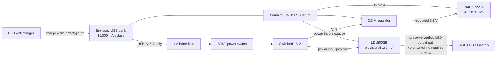

# Thursday USB-rechargeable prototype power plan

Prepared October 21, 2026 for Thursday, October 22. User authorized moving
to USB recharging for the presentation. Indoor harvesting is deferred for this
build. This is a proposed wiring plan, not an assembled or tested power system.

## Selected architecture and procurement

Use one enclosed 10,000 mAh USB-rechargeable power bank per pen node, its
ordinary 5 V USB-A output, and a separate 3.3 V regulator for the RAK board.
Charge the bank separately with the prototype switched off for this build.
Do not assume uninterrupted charge-through operation.

- Local-purchase candidate: Anker Power Bank (10K, 22.5W), A1388. Its official
  guide lists 5 V / 3 A USB-A output and a low-current mode. This mode is not
  treated as an indefinite always-on guarantee. Confirm the model on the box.
  [Anker guide](https://service.anker.com/article-description/Anker-Power-Bank-10K-22-5W-User-Guide).
- Regulator first choice: Adafruit LM3671 3.3 V breakout, product 2745,
  specified for 3.5–5.5 V input and up to 600 mA. The page showed in stock;
  next-day delivery to 29203 has NOT been confirmed.
  [Adafruit](https://www.adafruit.com/product/2745).
- Equivalent if already available: a documented fixed 3.3 V regulator module
  operating from 5 V and providing at least 300 mA at that input. Review the
  actual module's pinout and capacitor requirements before substitution.
  Pololu D24V5F3 is an electrical alternative, but its page showed a stock
  notification/backorder option; do not base Thursday on unconfirmed delivery.
  [Pololu](https://www.pololu.com/product/2842).
- Low-load-compatible alternative if obtainable: Voltaic V25, using its USB-A
  always-on output. Follow the exact revision's charging instructions; it is
  a different procurement option, not interchangeable port behavior.
  [Voltaic always-on documentation](https://voltaicsystems.com/always-on-batteries/).

Local stores verified from the retailer directory: Best Buy, 370 Harbison Blvd,
Columbia 29212; and 10136 Two Notch Rd, Suite 109D, Columbia 29229.
Specific model stock/pickup at these stores is NOT verified. Check local pickup
before traveling; do not rely on generic search-result pickup dates.
[Best Buy directory](https://stores.bestbuy.com/sc/columbia.html).

## Parts per pen node

| Qty | Item |
| --- | --- |
| 1 | Enclosed 10,000 mAh USB bank with 5 V output; test low-load behavior |
| 1 | Fixed 3.3 V regulator module as above |
| 1 | USB-A power breakout/cable exposing identified 5 V and GND |
| 1 | SPST DC power switch rated at least 1 A at 5 V |
| 1 | Inline 1 A fuse and holder, downstream of USB breakout |
| 1 | Existing LD1500SB, adjusted and checked near provisional 160 mA |
| 1 | Existing RGB LED assembly and mounting/thermal provisions |
| as needed | Insulated wiring, terminal strip/perfboard, enclosure/strain relief |

FDC6401N color switching remains the project candidate, but the complete LED
return path and LED common connection are not verified in the current record.
Do not treat this power diagram as a released transistor-level LED schematic.

## Power wiring diagram

Connection table is authoritative; diagram is functional, not a connector-face
view. Follow silkscreen/net names, not assumed wire colors or header orientation.

| From | To |
| --- | --- |
| USB-A breakout VBUS (+5 V) | Fuse input |
| Fuse output | SPST switch input |
| Switch output | Regulator VIN and LD1500SB power-input positive |
| USB-A breakout GND | Common ground terminal |
| Common ground | Regulator GND, LD1500SB power-input negative, RAK J3 pin 4 |
| Regulator 3.3 V output | RAK J3 pin 9 (3V3) |

Use plain USB-A 5 V power; no QC/PD voltage-trigger board. Keep USB data wires
isolated. Confirm 5 V at the breakout before attaching modules. Never feed
USB 5 V or a raw lithium cell directly into the RAK 3V3 pin: the board's
specified operating supply is 2.0–3.6 V.
[RAK pinout and supply](https://docs.rakwireless.com/product-categories/wisduo/rak3272-sip-breakout-board/datasheet/).

Disconnect RAKDAP1's 3V3 supply wire before external power. During programming,
use only a reviewed externally powered debug arrangement with common ground;
do not parallel the programmer supply with the regulator output.

The LD1500SB supplier specifies 2.9–6.1 V input, so 5 V fits its claimed range.
Actual module labeling, regulated current and temperature still require bench
verification. Its LED output return must not be arbitrarily tied to power GND:
that could bypass current regulation depending on the board topology.
[Supplier](https://eletechsups.com/driver-board-c-1_23/ld1500sb-adjustable-281500ma-output-current-high-brightness-led-constant-current-driver-board-for-flashlight-headlights-emergency-lights-p-502.html).

## Provisional energy target

Do not size this 5 V system using LED forward power alone. As a conservative
planning case, assume a linear driver draws approximately the LED current:
5 V * 0.163 A = 0.815 W from USB. Budget another 0.25 W at USB for logic/radio,
regulator and miscellaneous draw. That 0.25 W is an engineering allowance,
not a measured consumption figure or TX-peak limit.

Eight hours at 1.065 W = 8.52 Wh delivered by the bank. Add 30% planning margin:
11.08 Wh. Specify at least 12 Wh usable 5 V output for this scenario, to be
verified from the chosen bank's rating or a discharge test. A 10 Ah, 3.7 V cell
rating is 37 Wh nominal, not 50 Wh at USB; usable output is lower. The selected
capacity class provides substantial provisional margin but is not a runtime
guarantee. [Anker capacity explanation](https://www.anker.com/collections/10000-mah-power-bank).

This assumes one selected color at a time near 160 mA. A changed topology with
separate simultaneously powered color drivers requires a new budget. Linear
driver dissipation can approach (5 V - LED Vf) * current, roughly 0.36 W blue
or 0.48 W red at the reported operating points; measure temperature at 5 V.

## Build and presentation acceptance sequence

1. Obtain/identify the bank and regulator first; delivery is the immediate
   schedule dependency. No parts ordered and no availability promise made.
2. With RAK/LED disconnected, verify USB 5 V, regulator polarity and 3.3 V
   output. Remove power before completing connections.
3. Power RAK alone from the regulator, antenna attached; verify reliable boot
   and UART operation without the programmer supplying power.
4. Review the actual driver/LED pinout, then connect and check one color at low
   current before returning to the provisional visibility setting.
5. Finalize GPIO/MOSFET wiring and implement indicator states with gates held
   off at reset and no unintended simultaneous color selection. FDC6401N is
   specified at 2.5 V gate drive, but do not infer package pin numbers.
   [onsemi datasheet](https://www.onsemi.com/download/data-sheet/pdf/fdc6401n-d.pdf).
6. Test OFF and flashing states long enough to expose bank auto-shutdown. A
   low-current mode alone is not evidence of indefinite operation. If it shuts
   down, change to a verified always-on source or use USB wall power for the
   demonstration; report that limitation plainly. Do not hide it with FAULT LED.
7. Test steady red/blue thermals, repeated transitions, resets and battery
   unplug/replug. Charge separately before the presentation. Carry a compatible
   USB wall supply/cable as demo backup.

The existing software validates timers only; this power selection does not
establish completed indicators, radio transport or host integration. The next
hardware dependency is the actual regulator in hand and driver/LED connection
verification. Then prioritize one central plus one working pen node end to end
before duplicating the three-node prototype set.
